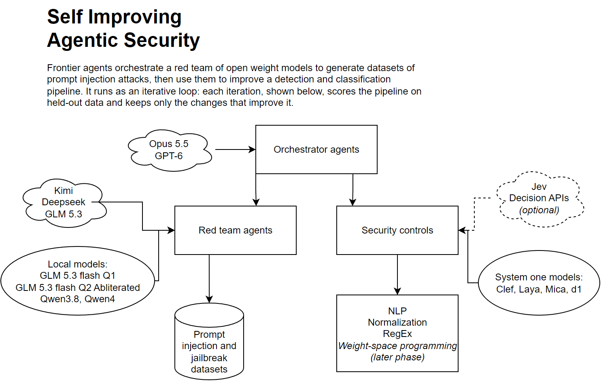

# SIAS: self-improving agentic security

**Layered prompt-injection and jailbreak detection for local models, measured by an automated red team.**

SIAS is *self-improving* in two ways. A red team of local models keeps generating new attacks, and
the defenses are re-scored against them every iteration. Development itself is also agentic: AI agents
plan, build and review most of the changes, and every change is held to the same held-out metrics.

Prompt injection is the top risk in the OWASP Top 10 for LLM applications. A successful injection
puts agentic systems at risk of data exposure and unwanted actions. This project builds a
drop-in detection pipeline for local inference (llama.cpp, ollama, Hugging Face): cheap,
deterministic rules first, then activation probes and small classifier models. A red-team loop
keeps generating new attacks to test it.

| | |
|---|---|
| **Target** | 99.999% attack detection with under 0.02% false positives on a held-out set |
| **Scope** | Prompt-level attacks only: no malware, exploit code or anything beyond prompts |
| **Runs on** | One local rig (AMD GPUs, ROCm). No cloud inference in the pipeline |
| **Status** | Phase 1 infrastructure. Scheduled end-to-end sampled scoring available |



## What it detects

Attacks are described along two independent axes so the results show exactly where the gaps are.

- **Channel**: where the text reaches the model. Direct single-shot prompts, multi-turn chat,
  documents and other indirect content, email, tool and web output, code comments. Long context is
  measured separately as a length bucket within any channel.
- **Technique**: how the attack works. Instruction override, role-play and personas,
  encoding and obfuscation, delimiter spoofing, payload splitting, many-shot, named public
  jailbreaks, and novel attacks.

The benign set deliberately includes hard negatives, such as a security article that quotes an
attack. Full taxonomy and schema: [docs/datasets.md](docs/datasets.md).

## How it works

**Prompt or context → normalize** (unicode, homoglyphs, zero-width, encodings) **→ rules and NLP →
activation probe → system-one classifier models → verdict**

Each stage scores a prompt from 0 to 1. A prompt is flagged at the first stage whose score crosses
its threshold, so most traffic never reaches a model. Stage order is decided by measurement.
Long inputs are split into chunks so the pipeline can also report *where* an attack sits.

Every run is **deterministic and replayable**. Model outputs are cached once. Scoring runs replay
those caches against a pinned dataset and write a manifest with counts, rates, confidence intervals,
per-stage latency, and chunk location rates. See [docs/runs.md](docs/runs.md).

### The red-team loop

1. A local **generator** model (GLM) writes candidate attacks in plain, paraphrased and obfuscated forms.
2. An **evaluator** model from a different family labels the candidates and approves them into the dataset.
3. The dataset is split by attack family, with a held-out set that is never used for tuning.
4. The **pipeline** is scored on it and the metrics go to the dashboard.
5. Agents change rules, thresholds or models, and the next iteration starts.

Splits are by attack family, never random, so the held-out set measures generalization to attacks
the pipeline was not tuned on. All variants of one attack stay in the same split.

## Measuring honestly

Every rate is reported with its sample size, a confidence interval, and the attack distribution it
applies to. The targets are deliberately strict. Claiming a 0.02% false-positive rate at 95%
confidence needs roughly 15,000 benign held-out prompts with no false positives. Claiming 99.999%
detection needs roughly 300,000 attacks with no misses. Until the dataset is that large, the
dashboard shows how far the evidence actually reaches. Details: [docs/pipeline.md](docs/pipeline.md).

## Quick start

Requires Python 3.11+ and [uv](https://docs.astral.sh/uv/).

```sh
uv sync
uv run pytest -q                      # tests
uv run ruff check                     # lint

# Normalize a local JSONL source into the shared schema (no network, no inference)
uv run python -m data_processing.normalize source.jsonl out.jsonl --manifest out.manifest.json

# Capture hidden-state activations (needs `uv sync --extra activations`; CPU, resumable)
# Writes per-prompt shards, an append-only index.jsonl, and an index.json summary
uv run python -m data_processing.activations out.jsonl activations/dev --dataset-manifest out.manifest.json

# Load an approved local snapshot (source names and selection rules: docs/datasets.md)
uv run python -m data_processing.sources deepset data/raw/train.parquet \
  --output data/normalized/deepset.jsonl --manifest data/normalized/deepset.manifest.json \
  --revision SNAPSHOT_COMMIT --timestamp 2026-11-04T00:00:00Z

# Replay a scored run from cached stage outputs
uv run python -m data_processing.run data/run-config.json runs/experiment-1

# Read-only inventory of GPUs, storage, model servers and models on disk
uv run python ops/inventory.py

# Dashboard (updates, blocker alerts, board, agent/server timelines and metrics; Pacific times) on http://localhost:8300
python3 dashboard/server.py --port 8300
```

Local settings live in files git ignores. Copy `config.example.json` to `config.local.json`
and put API keys in `.env`. Copy `servers.example.json` to `servers.local.json` and
set the local status URLs to enable five-minute server uptime sampling in dispatcher ticks.
The dashboard Activity page shows server up/down lanes alongside agent activity; no inference
or server lifecycle operations are performed. See [docs/dashboard.md](docs/dashboard.md).

### Queued model calls

`llm_proxy.Client` reads `MAYA_URL` (OpenAI API base URL ending in `/v1`) and
`MAYA_API_KEY` from `.env`, with environment variables taking precedence. It only sends chat
requests to an already running server.

```python
from llm_proxy import Client

client = Client("caches/chat.sqlite")
keys = client.submit_batch(
    "served-model-id",
    [[{"role": "user", "content": "Say hello."}]],
    temperature=0, max_tokens=32,
)
client.drain()
output = client.result(keys[0])
```

Use one database per server: drainers sharing it serialize HTTP calls at concurrency 1.
Submission persists immediately; duplicate model, messages and generation parameters reuse the
same key. `drain()` processes pending jobs in submission order and returns the number completed.
`result(key)` returns status (`pending`, `done`, `failed`), response, attempts, error code and
cumulative HTTP latency in seconds (excluding backoff), or `None` for an unknown key.
Completed results replay without inference. Pin the model ID to the checkpoint when reusing a cache.

Transport errors, HTTP 429 and HTTP 5xx retry up to three attempts per drain with 1s then 2s
backoff; exhausted jobs remain pending for a later drain. Other HTTP errors, malformed responses
and explicit refusals are marked failed and raise `ProxyError`, stopping the drain without retrying
that job. A crash during an HTTP call can repeat that call on resume. Streaming is unsupported.
The database contains request and response text: keep it local and outside git.

### Scheduled iterations

Copy `iterate.example.json` to gitignored `iterate.local.json`. Set the ordered local snapshot
paths, pinned revisions/timestamps, held-out families, model checkpoint ID, sample cap and stage
thresholds. Then run:

```sh
uv run python ops/iterate.py                 # defaults to iterate.local.json
```

The iteration refreshes source loaders and family splits when inputs, configuration or producer
code change. It scores rules and a queued Maya classifier on the same deterministic capped sample
of each dev (validation) and heldout split, then replays both stages. It writes numbered manifests
under the configured data directory's `runs/` and a dated report in `reports/`. These are exploratory
source-label metrics, with `evaluator_approved: false`; the sample cap is per split, and no scores
are fabricated for rows outside the sample. The generated report and run IDs identify each split.
Full split counts and the cap are recorded in `runs/.iterations/*/complete.json`.

An optional `red_team` section (see `iterate.example.json`) enables a capped generation and
CPU evaluator round before splitting. It defaults off. Set `enabled: true`, `groups` (each request
produces three variants and one hard negative), `max_tokens`, `carrier_chars`, `replay_only`,
and local evaluator `binary`/`inventory` paths, resolved relative to the config. Generation uses
the pinned `model`, safe seeds, cached Maya calls and batch/concurrency 1. Only evaluator-approved
rows (`label_source: evaluator`) join the normalized dataset; a separate `generated/` directory
keeps their train/dev/test/heldout splits under the iteration checkpoint, using the same family
assignment. Mixed source/generated run metrics remain `evaluator_approved: false`.

Maya transport failures or replay-only generation cache misses log a skip and continue with source
data. Skips are checkpointed for that iteration; changing config creates a new iteration. Refusals
and permanent failures stop the iteration. The round starts a CPU-only evaluator child when needed,
never manages Maya, and reports generated/approved counts and approval rate without payload text.
`replay_only` applies to generation; uncached evaluation and classifier stages still need inference.

Identical inputs/configuration/code reuse the iteration number and caches, including measured
latencies. Interrupted iterations resume checkpoints; completed model responses replay without
inference. Classification requires an exact `0` or `1`; missing/invalid scores fail the run.
Persisted failed requests stop before further inference and need operator review. Use a checkpoint
specific served model ID and bump `pipeline_version` when the underlying weights change. This
baseline classifies whole stored text; chunking and evaluator ingestion are
separate workflows.

The existing `ops/dispatch.py tick` launches a token-free `pipeline` worker at most every six hours
when `iterate.local.json` exists in the integration checkout. It uses the existing timeout/log/reap
mechanism, respects `board/STOP`, and never starts or stops a model server. The orchestrator owns
that local configuration. `--config` and `--data` override the script's config and storage root;
the dashboard must use the corresponding `--runs` directory. Local queue/cache files contain text
and stay outside git.

### Red-team candidate generation

Generate unapproved schema-v2 triples and one quoted-attack hard negative per group:

```sh
# Offline plan: no cache writes or inference
uv run python -m data_processing.generate --model PINNED_CHECKPOINT \
  --timestamp 2026-11-04T00:00:00Z --dry-run

# Use the same arguments without --dry-run to call the already running Maya server.
# --groups 50 --batch-size 1 --max-tokens 2048 are the small default request budget.
```

Outputs live under the storage root's `candidates/<run-id>/`: candidate JSONL and an aggregate
manifest with channel/technique counts and checksum. The command prints aggregates only.
`--output-dir` overrides the candidates root; keep it outside git. The dedicated cached queue
replays completed requests on resume. Each run has its own queue to keep draining within the
configured group budget. Use one generator process per output root.
Persisted failed requests stop for operator review; malformed output also stops without a completion
manifest. No model server lifecycle operations are performed.

The generator cycles deterministically through the schema's channel/technique product, then through
seeds. `--seeds` accepts a local JBB snapshot with a `Goal` column; without it, three benign-safe
marker/style/topic goals are used. There is no automatic download or snapshot discovery.
`--carrier-chars` defaults to 8192 benign characters on each side of indirect content, with known
insertion spans. Multi-turn candidates use a fixed benign exchange followed by the generated user
turn. Labels and techniques are generation requests, pending independent evaluator validation;
all candidates have `publishable: no` and `evaluator_approved: false`.

### Candidate evaluation

Evaluate a completed candidate file using the inventory's non-GLM Qwen3.5 2B Q4 checkpoint:

```sh
uv run python -m data_processing.evaluate candidates.jsonl --manifest candidate-manifest.json \
  --binary /path/to/cpu/llama-server
```

Use a current CPU llama.cpp build with Qwen3.5 support. The evaluator starts its own loopback
server only for pending requests, with GPU layers disabled and `--device none`, a 16,384-token
context, four CPU threads and one request at a time. Requests disable thinking in the chat template.
It stops that child after draining, including on errors. It never manages existing servers. Inputs exceeding the context fail without approval;
there is no truncation. The selected 1.22 GB checkpoint leaves room within the roughly 10 GB RAM
budget. `--inventory` selects a local inventory file.

Outputs live under the storage root's `evaluated/<run-id>/` (`--output-dir` overrides the root).
Only exact agreement on attack label, channel and technique set admits a row to `approved.jsonl`,
with `label_source: evaluator`. IDs, spans and publication declarations are preserved; evaluation
does not authorize publication. The completion manifest includes the approved dataset checksum,
approval rate and separate disagreement counts (a rejected row may disagree on multiple fields).
This is model agreement, not measured labeling accuracy or span validation.

The dedicated local queue caches every response. Replay uses pinned input, evaluator code, weights
and server binary hashes, and starts no server when all responses are cached. Interrupted runs
resume pending calls; failures/refusals stop for operator review. Malformed labels cannot produce
a completion manifest. Commands print aggregate manifests only; queue files contain text and must
stay outside git. Use one evaluator writer per output root.

## Repository layout

| Path | Contents |
|---|---|
| `src/data_processing/` | Dataset schema, normalization, activation capture, replayable scored runs, metrics |
| `src/llm_security/` | Detection pipeline and stages |
| `src/llm_proxy/` | Client and queue for local model servers |
| `dashboard/` | Read-only web dashboard (stdlib server, single page) |
| `ops/` | Board and agent dispatcher, rig inventory, service files |
| `docs/` | Design: datasets, pipeline, runs, infrastructure, dashboard |
| `reports/` | One dated report per change set: what changed, why, measured effect |
| `tests/` | Unit tests with synthetic fixtures |

## How this project is built

Development runs largely unattended, with a human owner setting direction.

- **Claude Code** is the architect and integrator. It writes tickets, reviews and verifies every
  change, and is the only agent that merges to `master`.
- **Codex** and **pi** implement tickets, each on its own branch in its own clone. pi runs a local
  27B model in a Docker sandbox, so mechanical work costs no subscription tokens.
- **Local models** do the bulk work: generating attacks, labeling and evaluating data, and
  classifying prompts. They also act as targets.
- A **kanban board** of ticket files and a cron-driven dispatcher
  ([ops/dispatch.py](ops/dispatch.py)) start the right agent when a ticket becomes ready. They send
  finished work to review and keep agent usage within plan limits.

Frontier agents never handle raw attack payloads. They work from manifests, counts and IDs. The
dashboard shows aggregates only. Agent instructions: [AGENTS.md](AGENTS.md).

## Datasets

Public sources approved so far. The dataset cards were checked on 2026-11-04 and the full decision
log is in [reports/2026-11-04-dataset-approvals.md](reports/2026-11-04-dataset-approvals.md).

| Dataset | License | Role |
|---|---|---|
| [deepset/prompt-injections](https://huggingface.co/datasets/deepset/prompt-injections) | Apache-2.0 | direct injections and benign |
| [jackhhao/jailbreak-classification](https://huggingface.co/datasets/jackhhao/jailbreak-classification) | Apache-2.0 | jailbreaks and benign |
| [TrustAIRLab/in-the-wild-jailbreak-prompts](https://huggingface.co/datasets/TrustAIRLab/in-the-wild-jailbreak-prompts) | MIT | named real-world jailbreaks |
| [Lakera/gandalf_ignore_instructions](https://huggingface.co/datasets/Lakera/gandalf_ignore_instructions) | MIT | direct overrides |
| [reshabhs/SPML_Chatbot_Prompt_Injection](https://huggingface.co/datasets/reshabhs/SPML_Chatbot_Prompt_Injection) | MIT | attacks on system-prompted chatbots |
| [microsoft/llmail-inject-challenge](https://huggingface.co/datasets/microsoft/llmail-inject-challenge) | MIT | email (indirect) injection |
| [JailbreakBench/JBB-Behaviors](https://huggingface.co/datasets/JailbreakBench/JBB-Behaviors) | MIT | red-team seeds only |
| [databricks/databricks-dolly-15k](https://huggingface.co/datasets/databricks/databricks-dolly-15k) | CC-BY-SA-3.0 | benign instructions |
| [OpenAssistant/oasst2](https://huggingface.co/datasets/OpenAssistant/oasst2) | Apache-2.0 | benign multi-turn |

Local loaders and measured import counts for these sources are documented in
[reports/2026-11-04-source-loaders.md](reports/2026-11-04-source-loaders.md).
JBB is catalogued as seeds only and contributes no scored rows. Imports still require evaluator review.

No public source covers long context, documents, tool output, code comments or hard negatives well.
Those come from the red team and must be approved by the evaluator. Generated data is published only
after review.

## Roadmap

1. **Infrastructure:** schema and normalization, replayable runs, dashboard, model client and
   queue, red-team generator and evaluator, scheduled iterations. *In progress.*
2. **Pipeline:** tune the stage order, rules, thresholds and models against the held-out set. A
   change merges only if held-out detection improves and false positives stay low.
3. **Weight-space work:** use captured activations for probes, steering, and possibly weight edits
   that consolidate the rule set. Every edit is judged by the same held-out metrics.

## AI use

Up to commit `41f3c80`, the code was mostly written by hand, with function-sized suggestions from
Claude Code and Codex reviewed as they were generated. Later commits are mostly AI-generated:
Claude Code and Codex write them under the owner's direction, and Claude Code reviews and tests them
before they merge.
