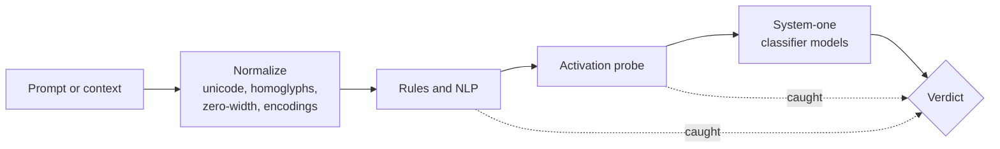
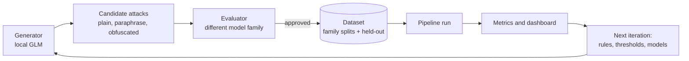

# llm-security

**Layered prompt-injection and jailbreak detection for local models, measured by an automated red team.**

Prompt injection is the top risk in the OWASP Top 10 for LLM applications. A successful injection
puts agentic systems at risk of data exposure and unwanted actions. This project builds a
drop-in detection pipeline for local inference (llama.cpp, ollama, Hugging Face): cheap,
deterministic rules first, then activation probes and small classifier models. A red-team loop
keeps generating new attacks to test it.

| | |
|---|---|
| **Target** | 99.999% attack detection with under 0.02% false positives on a held-out set |
| **Scope** | Prompt-level attacks only: no malware, exploit code or anything beyond prompts |
| **Runs on** | One local rig (AMD GPUs, ROCm). No cloud inference in the pipeline |
| **Status** | Phase 1 infrastructure. Working toward the first end-to-end scored iteration |

## What it detects

Attacks are described along two independent axes so the results show exactly where the gaps are.

- **Channel**: where the text reaches the model. Direct single-shot prompts, multi-turn chat,
  documents and other indirect content, email, tool and web output, code comments. Long context is
  measured separately as a length bucket within any channel.
- **Technique**: how the attack works. Instruction override, role-play and personas,
  encoding and obfuscation, delimiter spoofing, payload splitting, many-shot, named public
  jailbreaks, and novel attacks.

The benign set deliberately includes hard negatives, such as a security article that quotes an
attack. Full taxonomy and schema: [docs/datasets.md](docs/datasets.md).

## How it works



Each stage scores a prompt from 0 to 1. A prompt is flagged at the first stage whose score crosses
its threshold, so most traffic never reaches a model. Stage order is decided by measurement.
Long inputs are split into chunks so the pipeline can also report *where* an attack sits.

Every run is **deterministic and replayable**. Model outputs are cached once. Scoring runs replay
those caches against a pinned dataset and write a manifest with counts, rates, confidence intervals
and per-stage latency. See [docs/runs.md](docs/runs.md).

### The red-team loop



Splits are by attack family, never random, so the held-out set measures generalization to attacks
the pipeline was not tuned on. All variants of one attack stay in the same split.

## Measuring honestly

Every rate is reported with its sample size, a confidence interval, and the attack distribution it
applies to. The targets are deliberately strict. Claiming a 0.02% false-positive rate at 95%
confidence needs roughly 15,000 benign held-out prompts with no false positives. Claiming 99.999%
detection needs roughly 300,000 attacks with no misses. Until the dataset is that large, the
dashboard shows how far the evidence actually reaches. Details: [docs/pipeline.md](docs/pipeline.md).

## Quick start

Requires Python 3.11+ and [uv](https://docs.astral.sh/uv/).

```sh
uv sync
uv run pytest -q                      # tests
uv run ruff check                     # lint

# Normalize a local JSONL source into the shared schema (no network, no inference)
uv run python -m data_processing.normalize source.jsonl out.jsonl --manifest out.manifest.json

# Replay a scored run from cached stage outputs
uv run python -m data_processing.run data/run-config.json runs/experiment-1

# Read-only inventory of GPUs, storage, model servers and models on disk
uv run python ops/inventory.py

# Dashboard (board, agent activity, run metrics) on http://localhost:8300
python3 dashboard/server.py --port 8300
```

Local settings live in files git ignores. Copy `config.example.json` to `config.local.json`
and put API keys in `.env`.

## Repository layout

| Path | Contents |
|---|---|
| `src/data_processing/` | Dataset schema, normalization, replayable scored runs, metrics |
| `src/llm_security/` | Detection pipeline and stages |
| `src/llm_proxy/` | Client and queue for local model servers |
| `dashboard/` | Read-only web dashboard (stdlib server, single page) |
| `ops/` | Board and agent dispatcher, rig inventory, service files |
| `docs/` | Design: datasets, pipeline, runs, infrastructure, dashboard |
| `reports/` | One dated report per change set: what changed, why, measured effect |
| `tests/` | Unit tests with synthetic fixtures |

## How this project is built

Development runs largely unattended, with a human owner setting direction.

- **Claude Code** is the architect and integrator. It writes tickets, reviews and verifies every
  change, and is the only agent that merges to `master`.
- **Codex** implements tickets on its own branch, in its own clone.
- **Local models** do the bulk work: generating attacks, labeling and evaluating data, and
  classifying prompts. They also act as targets.
- A **kanban board** of ticket files and a cron-driven dispatcher
  ([ops/dispatch.py](ops/dispatch.py)) start the right agent when a ticket becomes ready. They send
  finished work to review and keep agent usage within plan limits.

Frontier agents never handle raw attack payloads. They work from manifests, counts and IDs. The
dashboard shows aggregates only. Agent instructions: [AGENTS.md](AGENTS.md).

## Datasets

Public sources approved so far. The dataset cards were checked on 2026-11-04 and the full decision
log is in [reports/2026-11-04-dataset-approvals.md](reports/2026-11-04-dataset-approvals.md).

| Dataset | License | Role |
|---|---|---|
| [deepset/prompt-injections](https://huggingface.co/datasets/deepset/prompt-injections) | Apache-2.0 | direct injections and benign |
| [jackhhao/jailbreak-classification](https://huggingface.co/datasets/jackhhao/jailbreak-classification) | Apache-2.0 | jailbreaks and benign |
| [TrustAIRLab/in-the-wild-jailbreak-prompts](https://huggingface.co/datasets/TrustAIRLab/in-the-wild-jailbreak-prompts) | MIT | named real-world jailbreaks |
| [Lakera/gandalf_ignore_instructions](https://huggingface.co/datasets/Lakera/gandalf_ignore_instructions) | MIT | direct overrides |
| [reshabhs/SPML_Chatbot_Prompt_Injection](https://huggingface.co/datasets/reshabhs/SPML_Chatbot_Prompt_Injection) | MIT | attacks on system-prompted chatbots |
| [microsoft/llmail-inject-challenge](https://huggingface.co/datasets/microsoft/llmail-inject-challenge) | MIT | email (indirect) injection |
| [JailbreakBench/JBB-Behaviors](https://huggingface.co/datasets/JailbreakBench/JBB-Behaviors) | MIT | red-team seeds only |
| [databricks/databricks-dolly-15k](https://huggingface.co/datasets/databricks/databricks-dolly-15k) | CC-BY-SA-3.0 | benign instructions |
| [OpenAssistant/oasst2](https://huggingface.co/datasets/OpenAssistant/oasst2) | Apache-2.0 | benign multi-turn |

No public source covers long context, documents, tool output, code comments or hard negatives well.
Those come from the red team and must be approved by the evaluator. Generated data is published only
after review.

## Roadmap

1. **Infrastructure:** schema and normalization, replayable runs, dashboard, model client and
   queue, red-team generator and evaluator, scheduled iterations. *In progress.*
2. **Pipeline:** tune the stage order, rules, thresholds and models against the held-out set. A
   change merges only if held-out detection improves and false positives stay low.
3. **Weight-space work:** use captured activations for probes, steering, and possibly weight edits
   that consolidate the rule set. Every edit is judged by the same held-out metrics.

## AI use

Up to commit `41f3c80`, the code was mostly written by hand, with function-sized suggestions from
Claude Code and Codex reviewed as they were generated. Later commits are mostly AI-generated:
Claude Code and Codex write them under the owner's direction, and Claude Code reviews and tests them
before they merge.
